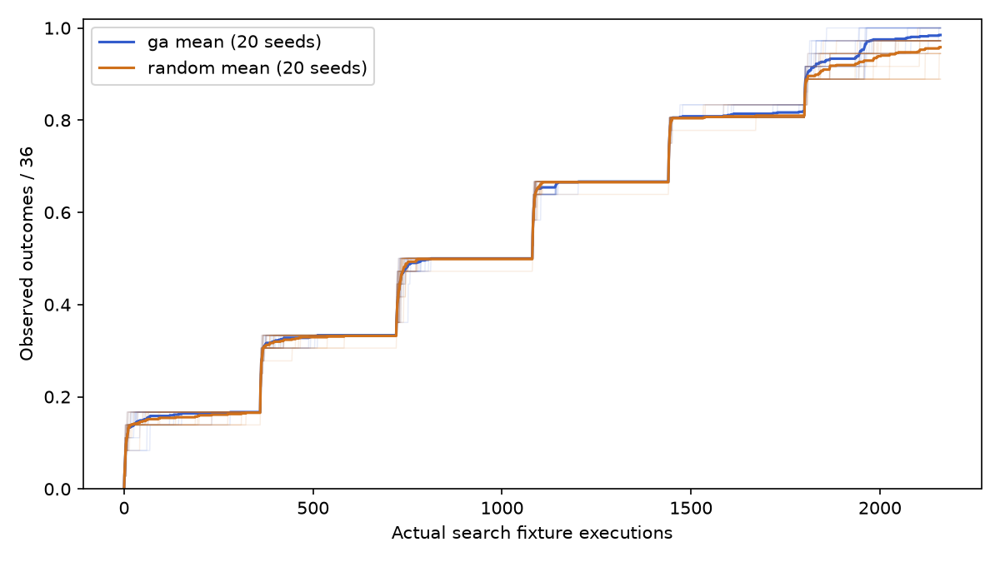

# Search-Based Test Generation

Project 5 applies optimization to automated software testing. An installed continuous GA
and independent Random Search generate bounded integer inputs for six static Python
fixtures. Real execution traces measure 36 predeclared decision outcomes under identical
budgets. The completed experiment and all raw evidence are included in this unmerged study.

| Measured across 20 seeds | GA | Random Search |
|---|---:|---:|
| Actual search calls | 43,200 | 43,200 |
| Mean final outcomes / 36 | 35.45 | 34.50 |
| Mean coverage | 98.47% | 95.83% |
| Coverage sample SD (percentage points) | 1.42 | 2.78 |
| Final outcome range | 35–36 | 32–36 |
| Mean normalized curve AUC | 0.56870 | 0.56274 |
| Mean distinct inputs per run | 1748.10 | 1981.05 |
| Mean duplicate rate | 19.07% | 8.28% |
| Mean search time (seconds) | 0.15361 | 0.11384 |
| Mean greedy suite size | 23.45 | 22.60 |

GA won 12 seed comparisons, tied 7 and lost 1. Random Search beat GA at seed 19.
These are descriptive findings on toy fixtures, with no significance or scale claim.
See [all per-seed results and figures](docs/RESULTS.md).



## Setup and verification

Python 3.10+; the VCS dependency requires Git and network access during installation.

```bash
python -m venv .venv
. .venv/bin/activate
pip install -e '.[dev,plots]'
pytest --cov=search_based_test_generation --cov-report=term-missing
pytest -q results/study/suites
ruff check .
ruff format --check .
python experiments/smoke_test.py
python experiments/audit_results.py
python -m build
```

Measured local checks: 370 tests passed, 94% package statement coverage, and all 921
exported regression cases passed. Ruff, builds and a clean wheel import outside the
checkout passed. [Verification](docs/VERIFICATION.md) records commands and real logs;
[CI](https://github.com/Ehsan-Rezaeii/search-based-test-generation/actions) checks Python
3.10/3.12/3.13. CI audits saved evidence and runs a tiny smoke, not the full experiment.

## Reproduce the frozen study

Run from the committed repository root. The frozen manifest refuses changed source;
use a fresh output directory. `study` never overwrites existing evidence.

```bash
sbst study --output /tmp/p5-reproduction
sbst audit --output /tmp/p5-reproduction
sbst reachability --output /tmp/p5-reachability.json
MPLCONFIGDIR=/tmp/p5-mpl python experiments/plot_results.py
```

Plot generation reads the saved `results/study` batch. Audit invokes no optimizers;
it recomputes counts, paths, fitness, coverage, duplicates, curves and greedy suites,
then replays the selected snapshots with separate accounting. For exact environment
versions see `experiments/prerun_manifest.json`. Seeds reproduce candidate inputs and
traces; elapsed times and provenance timestamps naturally vary.

The frozen protocol commit is `46d2b6e74fde166406e0154600ed69b453041e29`.
Manifest SHA-256: `73a5ea883ad880f20e35884041cada99d79f3b58ab448c3e2ff9e0137cd27ad2`.
[Project 1](https://github.com/Ehsan-Rezaeii/metaheuristics-lab/tree/6b4ef0fa3d72f608146f3dd7eabb84bf39fa896e)
is installed at commit `6b4ef0fa3d72f608146f3dd7eabb84bf39fa896e`; GA is neither copied
nor reimplemented. PEP 610 metadata, actual optimizer settings and source hashes are retained.

## Method and evidence

The fixtures are `threshold_gate`, `sign_balance`, `modulo_guard`, `distance_gate`,
`product_guard` (two arguments), and `triple_gate` (three). Each has exactly three
nested atomic decisions; every one of the 36 true/false outcomes is reachable in [-20,20].

Both optimizers use population 12, a continuous [-20.5,20.5] box and the same floor(v+0.5)
integer decoder. Each of the 36 targets receives exactly 60 actual fixture executions,
even after discovery, for each base seed 0..19. Derived seed is base*1000+target_index.
The observed union alone determines coverage. Fitness uses nested approach levels plus
normalized branch distance. All duplicates count; no caching or best-result reevaluation.

The 86,400 search calls are retained in `results/study/*.json.gz`. Summaries contain full
curves and discovery times. JSON suites and executable pytest files under `results/study/suites`
select only archived candidates by deterministic greedy set cover. The primary run replayed
921 selected cases separately. Offline reachability used 77,326 additional validation calls;
subsequent tests/audits/replays are also separate from the search budget.

## Reading guide and limitations

[Protocol](docs/EXPERIMENT_PROTOCOL.md) · [Specification](docs/PROJECT_SPEC.md) ·
[Beginner walkthrough](docs/IMPLEMENTATION_WALKTHROUGH.md) · [Handoff](docs/HANDOFF.md)

This is deliberate white-box search on public, hand-designed toy functions. There is no
ML holdout. A continuous GA over integer plateaus has representation limitations, and
product/modulo operand distances are heuristics. Short runs and fixed target order limit
interpretation; timings include instrumentation and are environment-specific. No ablation
isolates guidance effects. Greedy suites need not be minimum. Generated snapshots establish
**regression behavior**, not independent correct specifications; handwritten reference tests
remain separate. The study makes no industrial, cross-program or bug-finding claim.

## Attribution

The optimizer implementation is credited to [Project 1](https://github.com/Ehsan-Rezaeii/metaheuristics-lab).
Branch-distance and approach-level methods follow established SBST ideas; this is an
educational integration, not a novel optimizer. Background references:

- [Harman et al., Search Based Software Engineering: Techniques, Taxonomy, Tutorial](https://coinse.github.io/publications/pdfs/Harman2012lr.pdf)
- [Basic block coverage for search-based unit testing and crash reproduction](https://link.springer.com/article/10.1007/s10664-022-10155-0)
- [Coverage.py branch measurement](https://coverage.readthedocs.io/en/latest/branch.html)
- [Pynguin](https://pynguin.readthedocs.io/latest/) (background only; not an optimization backend)
