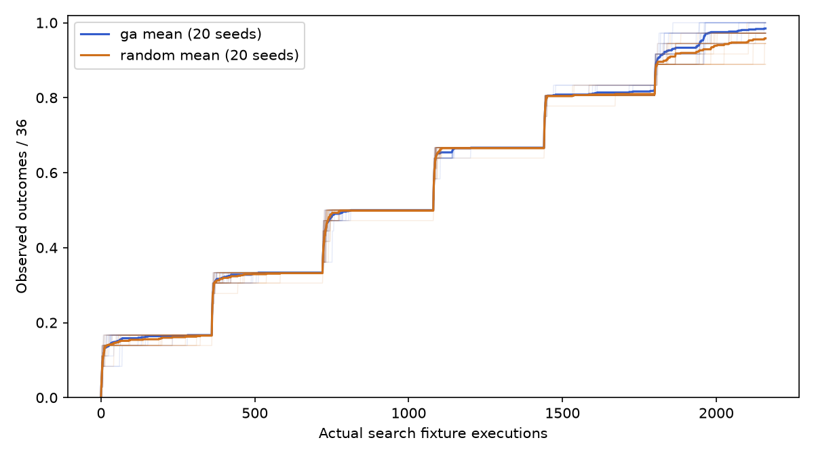
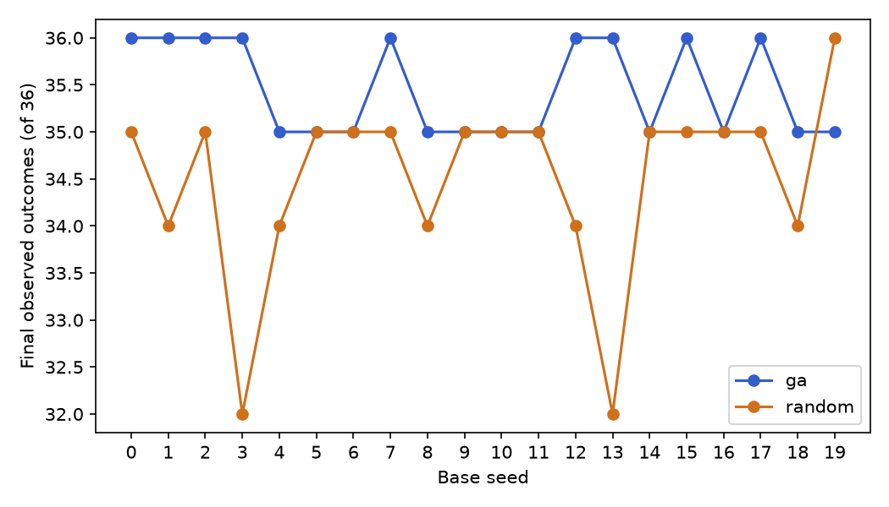
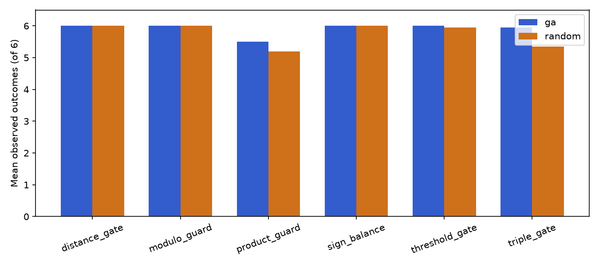

# Measured results

The full frozen primary experiment completed: 40 runs, 86,400 actual search calls. Each run used all 36 targets at 60 calls each. All 20 seeds are retained.

Descriptive statistics below use sample SD. Coverage is observed decision outcomes / 36. AUC is the preregistered right-step normalized curve sum. No significance or causal guidance claim is made.

| Method | Metric | Mean | Median | Sample SD | Min | Max |
|---|---|---:|---:|---:|---:|---:|
| ga | coverage | 0.984722 | 0.972222 | 0.014178 | 0.972222 | 1.000000 |
| ga | auc | 0.568702 | 0.569046 | 0.004903 | 0.561484 | 0.578678 |
| ga | unique_inputs | 1748.100000 | 1745.000000 | 18.475873 | 1720.000000 | 1788.000000 |
| ga | duplicate_rate | 0.190694 | 0.192130 | 0.008554 | 0.172222 | 0.203704 |
| ga | runtime_seconds | 0.153612 | 0.135616 | 0.044077 | 0.105225 | 0.257620 |
| ga | suite_size | 23.450000 | 23.000000 | 0.510418 | 23.000000 | 24.000000 |
| random | coverage | 0.958333 | 0.972222 | 0.027778 | 0.888889 | 1.000000 |
| random | auc | 0.562735 | 0.564185 | 0.007335 | 0.536638 | 0.573392 |
| random | unique_inputs | 1981.050000 | 1979.500000 | 13.682394 | 1952.000000 | 2013.000000 |
| random | duplicate_rate | 0.082847 | 0.083565 | 0.006334 | 0.068056 | 0.096296 |
| random | runtime_seconds | 0.113842 | 0.114528 | 0.023637 | 0.071151 | 0.154570 |
| random | suite_size | 22.600000 | 23.000000 | 0.753937 | 21.000000 | 24.000000 |

GA wins/ties/losses by paired base-seed final coverage: **12/7/1**. The methods share seed labels and initialization streams, not identical later candidates. Random Search is independent uniform testing under the same representation and schedule.

| Seed | GA outcomes | Random outcomes | Difference | GA unique | Random unique | GA suite | Random suite | GA seconds | Random seconds |
|---:|---:|---:|---:|---:|---:|---:|---:|---:|---:|
| 0 | 36 | 35 | 1 | 1735 | 1987 | 24 | 23 | 0.2451 | 0.0712 |
| 1 | 36 | 34 | 2 | 1720 | 1985 | 24 | 22 | 0.2576 | 0.1546 |
| 2 | 36 | 35 | 1 | 1777 | 1991 | 24 | 23 | 0.1414 | 0.0986 |
| 3 | 36 | 32 | 4 | 1739 | 1995 | 24 | 21 | 0.1620 | 0.0923 |
| 4 | 35 | 34 | 1 | 1728 | 2013 | 23 | 22 | 0.2159 | 0.1045 |
| 5 | 35 | 35 | 0 | 1750 | 1973 | 23 | 23 | 0.1663 | 0.1235 |
| 6 | 35 | 35 | 0 | 1754 | 1971 | 23 | 23 | 0.1280 | 0.1467 |
| 7 | 36 | 35 | 1 | 1758 | 1978 | 24 | 23 | 0.1565 | 0.1425 |
| 8 | 35 | 34 | 1 | 1730 | 1959 | 23 | 22 | 0.1957 | 0.1507 |
| 9 | 35 | 35 | 0 | 1749 | 1992 | 23 | 23 | 0.1782 | 0.1367 |
| 10 | 35 | 35 | 0 | 1738 | 1975 | 23 | 23 | 0.1382 | 0.1155 |
| 11 | 35 | 35 | 0 | 1741 | 1977 | 23 | 23 | 0.1162 | 0.1091 |
| 12 | 36 | 34 | 2 | 1753 | 1997 | 24 | 22 | 0.1194 | 0.1190 |
| 13 | 36 | 32 | 4 | 1788 | 1952 | 24 | 21 | 0.1330 | 0.1142 |
| 14 | 35 | 35 | 0 | 1740 | 1968 | 23 | 23 | 0.1189 | 0.1227 |
| 15 | 36 | 35 | 1 | 1745 | 1980 | 24 | 23 | 0.1052 | 0.1148 |
| 16 | 35 | 35 | 0 | 1745 | 1989 | 23 | 23 | 0.1197 | 0.0837 |
| 17 | 36 | 35 | 1 | 1728 | 1979 | 24 | 23 | 0.1284 | 0.0954 |
| 18 | 35 | 34 | 1 | 1785 | 1977 | 23 | 22 | 0.1238 | 0.0925 |
| 19 | 35 | 36 | -1 | 1759 | 1983 | 23 | 24 | 0.1225 | 0.0886 |

| Fixture | GA mean / 6 | Random mean / 6 |
|---|---:|---:|
| distance_gate | 6.000 | 6.000 |
| modulo_guard | 6.000 | 6.000 |
| product_guard | 5.500 | 5.200 |
| sign_balance | 6.000 | 6.000 |
| threshold_gate | 6.000 | 5.950 |
| triple_gate | 5.950 | 5.350 |

All first-hit outcome discovery times and full 2161-point per-run curves are in `results/study/summaries.json`. Each compressed run contains every candidate, operands, path, fitness and optimizer call summary. Unobserved targets remain absent from first-hit maps. Timing measures this environment and includes tracing, not export or suite minimization.

The six hand-designed toy functions favor transparent distance guidance and do not establish effectiveness on real software. A 60-call allocation gives very few generations. Integer decoding creates plateaus; continuous GA clipping and repeated inputs consume budget. Comparison-level product/modulo distances do not equal input edit distances. No ablation isolates distance from selection or approach levels. Greedy set cover is deterministic but not guaranteed minimum. Snapshot outputs prove regression consistency, not correctness; independent handwritten tests provide a separate limited reference. This is white-box search with no ML holdout.

## Outcome discovery and negative findings

| Outcome | GA runs covered / 20 | Random runs covered / 20 |
|---|---:|---:|
| threshold_gate:d1:T | 20 | 20 |
| threshold_gate:d1:F | 20 | 20 |
| threshold_gate:d2:T | 20 | 20 |
| threshold_gate:d2:F | 20 | 20 |
| threshold_gate:d3:T | 20 | 19 |
| threshold_gate:d3:F | 20 | 20 |
| sign_balance:d1:T | 20 | 20 |
| sign_balance:d1:F | 20 | 20 |
| sign_balance:d2:T | 20 | 20 |
| sign_balance:d2:F | 20 | 20 |
| sign_balance:d3:T | 20 | 20 |
| sign_balance:d3:F | 20 | 20 |
| modulo_guard:d1:T | 20 | 20 |
| modulo_guard:d1:F | 20 | 20 |
| modulo_guard:d2:T | 20 | 20 |
| modulo_guard:d2:F | 20 | 20 |
| modulo_guard:d3:T | 20 | 20 |
| modulo_guard:d3:F | 20 | 20 |
| distance_gate:d1:T | 20 | 20 |
| distance_gate:d1:F | 20 | 20 |
| distance_gate:d2:T | 20 | 20 |
| distance_gate:d2:F | 20 | 20 |
| distance_gate:d3:T | 20 | 20 |
| distance_gate:d3:F | 20 | 20 |
| product_guard:d1:T | 20 | 20 |
| product_guard:d1:F | 20 | 20 |
| product_guard:d2:T | 20 | 20 |
| product_guard:d2:F | 20 | 20 |
| product_guard:d3:T | 10 | 4 |
| product_guard:d3:F | 20 | 20 |
| triple_gate:d1:T | 20 | 20 |
| triple_gate:d1:F | 20 | 20 |
| triple_gate:d2:T | 20 | 18 |
| triple_gate:d2:F | 20 | 20 |
| triple_gate:d3:T | 19 | 12 |
| triple_gate:d3:F | 20 | 17 |

GA missed `product_guard:d3:T` in 10 runs and `triple_gate:d3:T` in one. Random Search missed product equality in 16 runs, threshold equality in one, and triple D3 outcomes in multiple runs (table above). A covered outcome can have been discovered incidentally in another allocation: targeted success and final archive discovery are recorded separately in `results/target_discovery.json`. No missing outcome is inferred from a distance estimate.

The fixed function-by-function target schedule dominates the staircase shape and AUC scale. AUC is a within-protocol descriptive metric, not a schedule-independent search-efficiency claim. GA used more duplicate inputs and more mean time; its higher mean final coverage does not imply that it wins each seed or is universally preferable.
